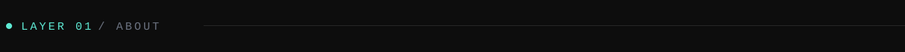
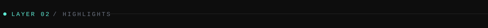
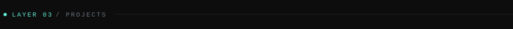
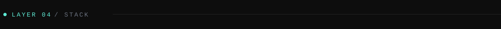

<p align="center">
  
</p>



```c#
>> who_am_i
Augustus Vennam // BSc CS + UX minor @ Wilfrid Laurier (Milton)
Frontend & UX · Embedded & Robotics · AI Agentic Workflows

>> current
Building BrainWaves: Emotiv EPOC X headset + Temi robot
pipeline, for the Nov 11 Open House demo

Building TempoSet in Flutter: metronome + setlist
manager for musicians

>> ask_me_about
Robotics / UX/Dev crossover / AI agent workflows
```



```c#
> Education                BSc Computer Science, Minor in UX Design
                           Wilfrid Laurier University (Milton)
                           Sep 2024 – Aug 2028 (expected)

> BrainWaves               Emotiv EPOC X headset, Basic streams only
                           (met / pow / dev / eq). A heuristic mood
                           estimate — not validated emotion detection.
                           Temi speaks the estimate; no movement
                           or navigation.

> TempoSet                 Flutter / Dart metronome + setlist manager
                           for musicians. Custom in-memory audio
                           engine, SQLite persistence, SoLoud.

> SmartWrite               Handwriting recognition, team project.
                           UI/UX + React 19 frontend lead; helped
                           train the team's PyTorch CNN.
```



```c#
001  BrainWaves Project        typescript + react. Lead contributor:
                               & designer of React dashboard
                               over a live WebSocket, 11 automated
                               tests passed. Mood is a heuristic demo.
                               Temi speaks the estimate via a
                               Wizard-of-Oz app, at most once a
                               minute; no navigation or movement.

002  TempoSet                  flutter / dart. Metronome + setlist
                               manager for musicians, built in
                               Flutter. Custom in-memory audio engine,
                               SQLite persistence, SoLoud.

003  SMART WRITE               react 19 + python (pytorch, contributed).
                               UI/UX + frontend lead on a handwriting-
                               recognition app. Helped train the team's
                               PyTorch CNN — training cycles, fine-
                               tuning, GPU-when-available setup.
                               Fellow devs tested the Canva prototype;
                               feedback moved button placement and
                               revised the demo.

004  HeavenBound Church        wordpress / elementor. Live, deployed
     Website                   site at hbcc.ca. Redesigned with UX
                               coursework; church members tested live
                               updates before full release.

006  Jetson Nano Facial        opencv. Face detection + age estimation
     Recognition Robot         on a Jetson Nano, onboard GPU inference,
                               and collaborative build.

007  Semi-Local AI Agent       jul 2026 – present. Designing and
     Workflows                 building semi-local AI agent workflows.
```



<p align="left">
  
  
  
  
  
  
  
  
  
  
  
</p>

<p align="left">
  <a href="https://www.linkedin.com/in/augustusvennam"></a>
</p>


